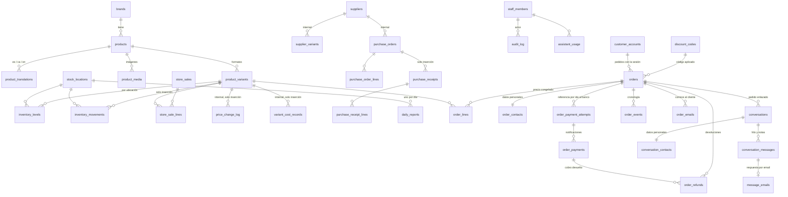

# Base de datos

Supabase (Postgres 17) con tres esquemas. Estado al 02/10/2026: 17 migraciones, las mismas en local, en CI y en `atelier-dev` (Frankfurt, `eu-central-1`). Este documento describe lo implementado; el diseño original de la Fase 1 está en `docs/source/FASE_1_PLAN.md` §7–§9 y las diferencias, en [DECISIONS.md](DECISIONS.md).

## Esquemas

| Esquema    | Expuesto por la API | Contenido                                                                                                                                                     | Acceso                                                                                                   |
| ---------- | ------------------- | ------------------------------------------------------------------------------------------------------------------------------------------------------------- | -------------------------------------------------------------------------------------------------------- |
| `public`   | Sí                  | Catálogo, inventario, personal, auditoría, contenido de la tienda, informes diarios y uso del asistente                                                       | RLS en todas las tablas; escritura sensible solo mediante funciones `admin_*`                            |
| `internal` | No                  | Costes, historial de PVP, proveedores, pedidos de compra, recepciones, control (tareas, costes, entregas, titulares y registro de copias) y visitas agregadas | Sin privilegios para `anon` ni `authenticated`; solo funciones `SECURITY DEFINER` con permiso y MFA      |
| `private`  | No                  | Funciones auxiliares (`has_permission`, `current_aal`, triggers), revisiones de PVP y de contenido, preasignación                                             | `authenticated` puede usar el esquema para que las políticas llamen a sus funciones; sin acceso a tablas |

`supabase/config.toml` expone solo `public` y `graphql_public`. En `atelier-dev`, una petición REST a `internal` o `private` con la clave publicable responde `PGRST106` («Only the following schemas are exposed: public, graphql_public»), comprobado el 02/10.

## Migraciones

Una migración por tema, aplicadas en `atelier-dev` con el conector de Supabase y guardadas con la misma versión en `supabase/migrations/` (DECISIONS §19).

| Versión          | Tema                                                                                                                                                                                                    |
| ---------------- | ------------------------------------------------------------------------------------------------------------------------------------------------------------------------------------------------------- |
| `20260929170331` | Extensiones, esquemas `internal` y `private`, `set_updated_at`, `reject_mutation` (solo inserción)                                                                                                      |
| `20260929170455` | Personal, permisos, matriz de roles, auditoría y `has_permission` / `current_aal`                                                                                                                       |
| `20260929170513` | Índices de claves foráneas del personal                                                                                                                                                                 |
| `20260929220732` | Catálogo: marcas, perfumes, textos, formatos, imágenes, historial de PVP, reglas de publicación y de precio, buckets                                                                                    |
| `20260929220840` | Inventario: ubicaciones, niveles, movimientos y funciones de movimiento y recuento                                                                                                                      |
| `20260929224423` | Gestión del personal desde el panel                                                                                                                                                                     |
| `20260929230737` | Niveles de stock borrados con su formato                                                                                                                                                                |
| `20260929232007` | Roles preasignados por email                                                                                                                                                                            |
| `20260930045615` | Costes internos por formato (solo inserción)                                                                                                                                                            |
| `20260930083657` | Registro de costes por lotes                                                                                                                                                                            |
| `20260930220818` | Guardas de MFA y del último administrador                                                                                                                                                               |
| `20260930220820` | Ediciones seguras: revisiones de PVP, foto principal única, precio anterior y auditoría del catálogo                                                                                                    |
| `20260930220822` | Contenido de la tienda con borrador, revisiones y publicación                                                                                                                                           |
| `20260930220824` | Invitaciones del personal                                                                                                                                                                               |
| `20260930224000` | Compras a proveedor, mostrador y vigilante de reposición                                                                                                                                                |
| `20261001090000` | Informes (existencias, cierre, compras)                                                                                                                                                                 |
| `20261002044249` | Informe diario y uso del asistente                                                                                                                                                                      |
| `20261009150000` | Perfil olfativo de cada perfume (catálogo olfativo de la tienda)                                                                                                                                        |
| `20261009150100` | Suscriptores a promociones y alta pública `newsletter_subscribe`                                                                                                                                        |
| `20261010120000` | Control del negocio: permiso `business.control`, precio cobrado en el mostrador y tareas, costes y entregas                                                                                             |
| `20261011090000` | Consola del titular: lista `internal.control_owners` y `control_access()`                                                                                                                               |
| `20261011090100` | Métricas por producto: series por formato y día, semana o mes, e historial de PVP y coste                                                                                                               |
| `20261011090200` | Visitas anónimas agregadas: `internal.product_attention_daily` y `track_product_event` (pública, con freno)                                                                                             |
| `20261011090300` | Copias (bucket privado `system-backups`, exportación por lista blanca y registro), estado, uso del asistente y calidad                                                                                  |
| `20261011230000` | Pedidos web: pedido, líneas, contacto, intentos de pago, notificaciones, cronología, reserva y caducidad (PR #31, P02)                                                                                  |
| `20261012120000` | Checkout: zonas y tarifas de envío (`shipping_rates`), envío en `web_order_create` y tienda por defecto (PR #31, P03)                                                                                   |
| `20261012180000` | Pago con tarjeta: `web_order_status` para la página de vuelta del banco, sin datos personales (PR #31, P04)                                                                                             |
| `20261012190000` | Correos de los pedidos: cola `order_emails`, encolado por disparador y envío solo del servidor (PR #31, P06)                                                                                            |
| `20261012200000` | Devoluciones: `order_refunds`, solicitud del panel y resultado del banco (PR #31, P06)                                                                                                                  |
| `20261015120000` | Códigos de descuento: `discount_codes`, descuento en `orders` y en `web_order_create`, panel y comprobación (§149–152)                                                                                  |
| `20261016120000` | Cuenta de cliente: `customer_accounts`, `orders.customer_id`, `customer_*` y `web_order_create` con la cuenta (C01)                                                                                     |
| `20261017120000` | Revisión de seguridad: `product_sources` (procedencia solo para el personal), MFA en todos los permisos, rol solo para cuentas confirmadas y `web_order_rate_limit` (§158–162)                          |
| `20261021120000` | Bandeja de mensajes (A6.1): conversaciones, contacto, mensajes, cola de respuestas, plantillas y clave de respuesta                                                                                     |
| `20261023120000` | «Liberar la reserva» de un pedido sin pagar: `admin_release_order_reservation` (§164)                                                                                                                   |
| `20261024120000` | Devoluciones más seguras: `order_refunds.sent_at`, `admin_resolve_refund` y pasos bloqueados con una devolución abierta (§168)                                                                          |
| `20261025120000` | Envíos multitransportista: peso de los formatos, ajustes, servicios y tramos de coste (internal), servicio elegido y peso en `orders`, `web_shipping_quote`, envíos, recogidas y seguimiento (§171–176) |

No hay `seed.sql`: los datos de referencia (permisos, matriz de roles, ubicación de la tienda, parámetros del vigilante) viven en las migraciones. Las cargas de datos reales están en `supabase/data/` y se aplicaron una vez en `atelier-dev`; no forman parte de `db reset`.

## Tablas y RLS

Denegar por defecto: sin política, no hay acceso. «Público» es `anon` y también `authenticated` sin ficha de personal.

| Tabla                                                                               | Público                                                                               | Personal (permiso)                                                                                                                                                                                                      |
| ----------------------------------------------------------------------------------- | ------------------------------------------------------------------------------------- | ----------------------------------------------------------------------------------------------------------------------------------------------------------------------------------------------------------------------- |
| `brands`                                                                            | Marcas con algún perfume publicado                                                    | Lee todas; escribe con `catalog.edit`                                                                                                                                                                                   |
| `products`                                                                          | Publicados                                                                            | Lee todos; escribe con `catalog.edit`; publicar o retirar exige `catalog.publish` (trigger)                                                                                                                             |
| `product_sources`                                                                   | — (la procedencia puede nombrar al proveedor, §158)                                   | Lee el personal con MFA; escribe con `catalog.edit`; auditada                                                                                                                                                           |
| `product_translations`                                                              | Textos de perfumes publicados                                                         | Lee todos; escribe con `catalog.edit` o `content.edit`                                                                                                                                                                  |
| `product_variants`                                                                  | Formatos activos de perfumes publicados                                               | Lee todos; escribe con `catalog.edit`; PVP y precio anterior solo con `pricing.edit_retail` y MFA (trigger)                                                                                                             |
| `product_media`                                                                     | Imágenes de perfumes publicados                                                       | Lee todas; escribe con `media.edit`                                                                                                                                                                                     |
| `product_scent_profiles`                                                            | Perfiles de perfumes publicados                                                       | Lee todos; escribe con `catalog.edit` o `research.edit`. Notas como claves; fuente `https` obligatoria                                                                                                                  |
| `newsletter_subscribers`                                                            | Ni lee ni escribe; solo da de alta con `newsletter_subscribe()`                       | Lee con `customers.view`; da de baja o borra con `customers.manage` (MFA); nadie inserta por la API                                                                                                                     |
| `store_content`                                                                     | La revisión publicada de la portada y los datos de la tienda                          | Escritura solo con `admin_*_content` (`content.edit` / `settings.manage`, con MFA)                                                                                                                                      |
| `stock_locations`                                                                   | —                                                                                     | Lee el personal; escribe con `settings.manage`                                                                                                                                                                          |
| `inventory_levels`, `inventory_movements`                                           | —                                                                                     | Lee con `inventory.view`; escribe solo mediante funciones                                                                                                                                                               |
| `store_sales`, `store_sale_lines`                                                   | —                                                                                     | Lee con `inventory.view`; escribe `admin_record_store_sale`                                                                                                                                                             |
| `orders`, `order_lines`, `order_payment_attempts`, `order_payments`, `order_events` | —                                                                                     | Lee con `orders.view`; escriben solo `web_order_*` (servidor) y `admin_transition_order`                                                                                                                                |
| `order_contacts`                                                                    | —                                                                                     | Lee con `orders.view` **y** `customers.view`; escribe solo `web_order_create`                                                                                                                                           |
| `customer_accounts`                                                                 | Cada cliente lee su ficha; escribe solo `customer_save_account`                       | — (la ficha de cliente del panel llega con A7)                                                                                                                                                                          |
| `shipping_rates`                                                                    | Las zonas activas (gratis desde); `price_cents` sin uso desde `20261025120000`        | Lee todas el personal con MFA; escribe `admin_save_shipping_zone` (`settings.manage`)                                                                                                                                   |
| `shipping_settings`                                                                 | —                                                                                     | Lee con `orders.view`; escribe `admin_save_shipping_settings` (`settings.manage`)                                                                                                                                       |
| `shipping_services`                                                                 | — (la tienda recibe nombre, plazo y precio con `web_shipping_quote`)                  | Lee con `orders.view`; escriben `admin_save_shipping_service` y `admin_shipping_sync` (`settings.manage`)                                                                                                               |
| `shipments`, `shipment_events`, `shipment_pickups`                                  | —                                                                                     | Lee con `orders.view`; escriben `admin_record_shipment`, `admin_cancel_shipment`, `admin_record_pickup` y `admin_record_dropoff` (`orders.fulfill`) y `web_shipment_event` (servidor); `shipment_events` solo inserción |
| `discount_codes`                                                                    | — (la tienda los comprueba en el servidor con `web_order_discount_quote`)             | Lee con `promotions.manage` (MFA); escribe `admin_save_discount_code`; usos con `admin_list_discount_codes`                                                                                                             |
| `conversations`, `conversation_messages`, `message_emails`, `message_templates`     | —                                                                                     | Lee con `messages.view`; escriben `admin_*` de mensajes (`messages.reply`, MFA) y el servidor (`web_contact_submit`, `web_inbound_email_record`, cola)                                                                  |
| `conversation_contacts`                                                             | —                                                                                     | Lee con `messages.view` y `customers.view`; la escribe solo el servidor                                                                                                                                                 |
| `order_emails`                                                                      | —                                                                                     | Lee con `orders.view` (estado, sin contenido); escriben el disparador y `web_order_email*` (servidor)                                                                                                                   |
| `order_refunds`                                                                     | —                                                                                     | Lee con `orders.view`; pide `admin_request_refund` (`orders.refund`, MFA); resuelve solo el servidor                                                                                                                    |
| `stock_watch_settings`                                                              | —                                                                                     | Lee con `inventory.view`; escribe `admin_set_stock_watch_settings` (`settings.manage`)                                                                                                                                  |
| `staff_members`                                                                     | —                                                                                     | Cada miembro lee su ficha; `staff.manage` gestiona                                                                                                                                                                      |
| `permissions`, `role_permissions`                                                   | —                                                                                     | Lee el personal; nadie escribe por la API                                                                                                                                                                               |
| `audit_log`                                                                         | —                                                                                     | Lee `staff.manage`; se escribe con `record_audit_event` y triggers                                                                                                                                                      |
| `daily_reports`                                                                     | —                                                                                     | Lee `agent.use`; solo escribe el servidor con la clave privilegiada                                                                                                                                                     |
| `assistant_usage`                                                                   | —                                                                                     | Cada persona inserta y ve lo suyo con `agent.use` y MFA; `staff.manage` ve todo                                                                                                                                         |
| `internal.*`                                                                        | Inalcanzable                                                                          | Solo mediante funciones `admin_*`                                                                                                                                                                                       |
| `storage.objects`: `product-media` (público), `editorial` (privado)                 | `product-media`: lectura pública; `editorial`: solo la imagen de la portada publicada | `product-media`: escribe `media.edit`; `editorial`: lee y sube el personal con permiso de contenido                                                                                                                     |

Además, `anon` y `authenticated` no tienen `TRUNCATE` en ninguna tabla pública y `anon` no tiene `INSERT`, `UPDATE` ni `DELETE` (pgTAP `07`).

### Solo inserción

`UPDATE` y `DELETE` fallan para todos los roles, incluido el propietario de la base (`private.reject_mutation`, error `42501`): `audit_log`, `inventory_movements`, `store_sales`, `store_sale_lines`, `order_lines`, `order_payment_attempts`, `order_payments`, `order_events`, `shipment_events`, `assistant_usage`, `internal.price_change_log`, `internal.variant_cost_records`, `internal.purchase_receipts`, `internal.purchase_receipt_lines` y `private.store_revisions`.

## Funciones

Todas las funciones `admin_*` son `SECURITY DEFINER` con `search_path` vacío, comprueban el permiso (y MFA cuando el permiso lo exige) al empezar y no son ejecutables por `anon`. El asesor de Supabase las marca como ejecutables por `authenticated`: es intencionado (DECISIONS §20 y §35).

| Área        | Funciones                                                                                                                                                                                                                                                                                                                                                                                                                                                                                                                                                                                                                            | Permiso                                                                                                                                     |
| ----------- | ------------------------------------------------------------------------------------------------------------------------------------------------------------------------------------------------------------------------------------------------------------------------------------------------------------------------------------------------------------------------------------------------------------------------------------------------------------------------------------------------------------------------------------------------------------------------------------------------------------------------------------ | ------------------------------------------------------------------------------------------------------------------------------------------- |
| Precios     | `admin_review_price`, `admin_apply_price_review`, `admin_variant_price_history`                                                                                                                                                                                                                                                                                                                                                                                                                                                                                                                                                      | `pricing.edit_retail` (+ `pricing.view_cost` al revisar); historial también con `catalog.edit`                                              |
| Costes      | `admin_variant_costs`, `admin_record_variant_cost`, `admin_record_variant_costs`                                                                                                                                                                                                                                                                                                                                                                                                                                                                                                                                                     | `pricing.view_cost` / `pricing.edit_cost`                                                                                                   |
| Imágenes    | `admin_set_primary_media`                                                                                                                                                                                                                                                                                                                                                                                                                                                                                                                                                                                                            | `media.edit`                                                                                                                                |
| Inventario  | `admin_record_inventory_movement`, `admin_record_stocktake`, `admin_inventory_once`, `admin_set_reorder_point`, `admin_stock_watch_facts`, `admin_set_stock_watch_settings`                                                                                                                                                                                                                                                                                                                                                                                                                                                          | Según el tipo de movimiento (`private.movement_permission`), `inventory.stocktake`, `inventory.adjust`, `inventory.view`, `settings.manage` |
| Pedidos web | `admin_transition_order` (panel); `admin_request_refund` y `admin_retry_refund` (`orders.refund`, P06); `admin_save_discount_code` y `admin_list_discount_codes` (`promotions.manage`, §151); `web_order_create`, `web_order_new_attempt`, `web_order_record_payment`, `web_order_release_expired`, `web_order_status`, `web_order_emails_claim`, `web_order_email_result`, `web_order_refund_result`, `web_order_discount_quote` (solo `service_role`, DECISIONS §131)                                                                                                                                                              | Transiciones de `status.ts`: `orders.fulfill` u `orders.refund`, siempre con MFA; reembolsos y envío bloqueados hasta P06 y tarifas         |
| Envíos      | `admin_save_shipping_settings`, `admin_save_shipping_zone`, `admin_shipping_services` (importes con `pricing.view_cost`), `admin_shipping_sync`, `admin_save_shipping_service`, `admin_save_shipping_service_rates` (también `pricing.view_cost`) (`settings.manage`); `admin_save_variant_weights` (`catalog.edit`); `admin_record_shipment`, `admin_cancel_shipment`, `admin_record_pickup`, `admin_record_dropoff` (`orders.fulfill`); `admin_shipment_costs` (`pricing.view_cost`). Tienda: `web_shipping_quote` (pública: opciones y precio por peso, sin costes). Servidor: `web_shipment_event` (aviso firmado del proveedor) |
| Mensajes    | `admin_reply_conversation`, `admin_add_conversation_note`, `admin_set_conversation_status`, `admin_assign_conversation`, `admin_link_conversation_order` (también `orders.view`), `admin_save_message_template`, `admin_message_assignees` (`messages.view`), `admin_delete_conversation` (`customers.manage`); `web_contact_submit`, `web_inbound_email_record`, `web_message_emails_claim`, `web_message_email_result` (solo `service_role`, DECISIONS §154)                                                                                                                                                                       | `messages.reply` con MFA; revisión optimista; auditoría sin texto ni email                                                                  |
| Mostrador   | `admin_record_store_sale`                                                                                                                                                                                                                                                                                                                                                                                                                                                                                                                                                                                                            | `inventory.sell_in_store`                                                                                                                   |
| Compras     | `admin_list_suppliers`, `admin_save_supplier`, `admin_save_supplier_variant`, `admin_remove_supplier_variant`, `admin_assign_supplier_brand`, `admin_supplier_terms`, `admin_create_purchase_order`, `admin_update_purchase_order`, `admin_delete_purchase_order`, `admin_transition_purchase_order`, `admin_set_purchase_order_lines`, `admin_list_purchase_orders`, `admin_purchase_order_lines`, `admin_purchase_order_receipts`, `admin_receive_purchase_order`, `admin_open_purchase_orders`                                                                                                                                    | `purchasing.manage` (+ `pricing.view_cost` / `pricing.edit_cost` con importes); pedidos abiertos con `inventory.view`                       |
| Informes    | `admin_report_inventory_period`, `admin_report_purchases`                                                                                                                                                                                                                                                                                                                                                                                                                                                                                                                                                                            | `reports.view` / `purchasing.manage` (+ `pricing.view_cost` para importes)                                                                  |
| Control     | `admin_control_tasks`, `admin_control_save_task`, `admin_control_set_task_status`, `admin_control_delete_task`, `admin_control_costs`, `admin_control_save_cost`, `admin_control_delete_cost`, `admin_control_deliveries`, `admin_control_save_delivery`, `admin_control_delete_delivery`, `admin_control_month_facts`                                                                                                                                                                                                                                                                                                               | `business.control` con MFA y en `internal.control_owners` (el titular)                                                                      |
| Consola     | `control_access`, `admin_control_variant_series`, `admin_control_variant_events`, `admin_control_attention`, `admin_control_export_catalog`, `admin_control_export`, `admin_control_log_backup`, `admin_control_backups`, `admin_control_system_status`, `admin_control_assistant_usage`, `admin_control_data_quality`                                                                                                                                                                                                                                                                                                               | Titular con MFA; exportación y registro de copias también `service_role` (copia diaria)                                                     |
| Contenido   | `admin_get_content`, `admin_save_content`, `admin_publish_content`, `admin_restore_content`                                                                                                                                                                                                                                                                                                                                                                                                                                                                                                                                          | `private.check_content_access`: `content.edit` (portada) o `settings.manage` (datos de la tienda), con MFA                                  |
| Personal    | `admin_list_staff`, `admin_grant_staff`, `admin_set_staff_active`, `admin_prepare_invite`, `admin_pending_invites`, `admin_cancel_invite`                                                                                                                                                                                                                                                                                                                                                                                                                                                                                            | `staff.manage`                                                                                                                              |
| Otras       | `record_audit_event` (personal activo), `storefront_availability` (pública: solo disponible, últimas unidades o agotado), `newsletter_subscribe` (pública: alta normalizada, sin revelar si existía, con freno de 60 altas por minuto), `track_product_event` (pública: suma una visita a un perfume publicado, sin revelar nada, con freno de 1200 por minuto)                                                                                                                                                                                                                                                                      | —                                                                                                                                           |

**Cuenta de cliente (C01):** `customer_orders`, `customer_order` y `customer_save_account` son `SECURITY DEFINER`, solo para `authenticated` (no `anon`) y cada una ve únicamente la cuenta de la sesión (`auth.uid()`): sus pedidos (los vinculados al hacerlos con la sesión y los de invitado con su email, si lo tiene verificado) y su ficha. No devuelven identificadores internos, cobros ni cronología. `web_order_create` admite `p_customer_id`, la cuenta que el servidor validó con Supabase Auth. pgTAP `18` exige que toda función ejecutable por una sesión compruebe permiso o MFA, salvo una lista de públicas por diseño.

`admin_stock_watch_facts` y `admin_open_purchase_orders` aceptan también `service_role` para la tarea programada del informe diario (`private.is_service_role()`).

## Diagrama

## Pruebas y comprobaciones

| Qué                                       | Dónde                                                                             | Cuándo                         |
| ----------------------------------------- | --------------------------------------------------------------------------------- | ------------------------------ |
| pgTAP (813 pruebas en 21 archivos)        | `supabase/tests/database/`, `pnpm test:db`                                        | `db.yml`, en cada PR y en main |
| Tipos generados iguales a las migraciones | `scripts/check-db-types.ts`                                                       | `db.yml`                       |
| `supabase db lint` (plpgsql_check)        | `scripts/check-db-lint.ts`, con 3 falsos positivos conocidos de tablas temporales | `db.yml`                       |
| Concurrencia real (sesiones simultáneas)  | `supabase/tests/concurrency/`, `scripts/test-concurrency.ts`                      | `db.yml`                       |
| Coste centinela fuera de la tienda        | `tests/fixtures/test-db.sql` + `tests/e2e/cost-leak.spec.ts`                      | `e2e.yml`                      |

Archivos pgTAP: `01` personal y permisos, `02` catálogo e inventario, `03` costes, `04` entregas de administración y compras/mostrador, `05` informes, `06` asistente `07` garantías de la Fase 1 (RLS en todas las tablas, `anon` sin funciones `admin_*`, PVP sin permiso, publicación y solo inserción) `08` perfil olfativo y suscriptores (lectura pública solo de publicados, restricciones del perfil, alta pública normalizada que no revela si el email existía, lectura y baja solo con `customers.*`) `09` control del negocio (solo el titular con MFA, otro `system_admin` sin acceso, `internal` inalcanzable, auditoría sin importes, precio cobrado en el mostrador sin superar el PVP y hechos del mes), `10` métricas por producto (series, existencias y días con stock, historial de PVP y coste), `11` visitas (solo publicados, sin revelar nada, freno por minuto, lectura solo del titular) `12` copias y estado (lista blanca, rol de servicio, bucket privado, registro de solo inserción, estado del sistema, uso del asistente y calidad de datos) y `13` pedidos web (solo el servidor crea y cobra, precio del catálogo, reserva todo o nada e idempotente, decisión ante cada notificación, caducidad y pago tardío, lectura por permiso con el contacto aparte y transiciones con su efecto de inventario) y `14` checkout (zonas por código postal, tarifas solo con `settings.manage` y MFA y auditadas, la tienda solo ve las activas, envío calculado en la base con envío gratis, teléfono y dirección obligatorios y guardados solo si hay envío, y tienda por defecto), `15` pago (estado del pedido solo para el servidor y sin datos personales, reintento con otra referencia), `16` correos (encolado con el paso que lo motiva y una vez por pedido, lectura con `orders.view`, envío y reintentos solo del servidor), `17` devoluciones (solo `orders.refund` con MFA pide, solo el servidor resuelve, importes acotados a lo cobrado, idempotencia, una abierta por pedido, parcial y resto, cobro de más y reenvío sin respuesta), `18` cuenta de cliente (una cuenta de cliente, con o sin aal2, no ve en ninguna tabla pública más que un visitante ni pasa funciones del panel; toda función de sesión tiene guarda o es pública por diseño; pedidos propios por vínculo o por email verificado, sin los caducados; ficha validada; al borrar la cuenta se borra la ficha y el pedido se conserva sin vínculo) `19` códigos de descuento (solo `promotions.manage` con MFA crea y ve códigos, auditados; la tienda los comprueba en el servidor; porcentaje o importe, compra mínima, fechas, usos máximos y uso por email; rebajados fuera si el código lo pide; envío gratis con el descuento ya aplicado; el uso de un pedido caducado vuelve; cobro por el total con descuento) y `20` revisión de seguridad (la procedencia solo la lee el personal con MFA, ningún permiso sin MFA, rol solo para cuentas confirmadas y freno de peticiones solo del servidor).

`db reset` solo se ejecuta en local y en CI. En `atelier-dev` borraría datos reales (catálogo, stock, fotos y cuentas): allí se comprueba la paridad de versiones con la lista de migraciones (DECISIONS §85).
