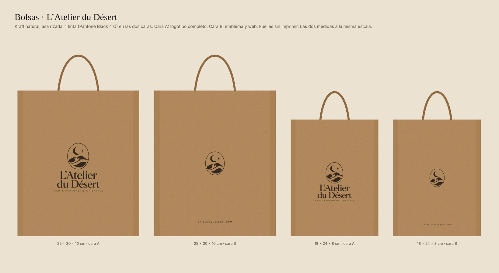

# Bolsas de papel · L’Atelier du Désert

Diseño elegido el 26/11/2026 (DECISIONS §200): el primero de los tres que se probaron, con el logotipo de la web (`public/brand/logo.svg`). Kraft natural, una tinta, dos caras.

## Pedido

|                                | Bolsa grande                                                        | Bolsa pequeña                     |
| ------------------------------ | ------------------------------------------------------------------- | --------------------------------- |
| Medida (ancho × alto × fuelle) | 25 × 30 × 10 cm (o la de catálogo más cercana, p. ej. 24 × 31 × 12) | 18 × 24 × 8 cm                    |
| Cantidad                       | 500                                                                 | 500                               |
| Papel                          | Kraft natural, 100–120 g/m²                                         | Kraft natural, 100–120 g/m²       |
| Asa                            | Rizada (cordón de papel)                                            | Rizada (cordón de papel)          |
| Tinta                          | 1 tinta directa: Pantone Black 4 C (negro cálido) o negro estándar  | Igual                             |
| Cara A                         | Logotipo completo, 100 mm de ancho                                  | Logotipo completo, 80 mm de ancho |
| Cara B                         | Emblema de 40 mm y `LATELIERDUDESERT.COM` al pie                    | Emblema de 31 mm y la web al pie  |
| Fuelles y fondo                | Sin imprimir                                                        | Sin imprimir                      |

## Archivos

- `bolsa-<medida>-cara-A.pdf` / `.svg` y `bolsa-<medida>-cara-B.pdf` / `.svg`: arte final a tamaño real (1:1), vectorial, una sola tinta, textos en trazos y sin imágenes. Es lo que se manda a la imprenta.
- `ficha-tecnica-bolsas.pdf`: una página por medida, con las dos caras, cotas y especificaciones.
- `mockup-bolsas-kraft.jpg`: vista previa; no sirve para imprimir.

Origen del arte: el emblema y el logotipo completo son los trazos de `public/brand/logo.svg` (DECISIONS §56), sin redibujar. La web va en Manrope 500, en mayúsculas espaciadas como el lema, convertida en trazos.

**Trazo mínimo:** el lema «Haute Parfumerie Orientale» queda en unos 0,3 mm en la bolsa grande y 0,26 mm en la pequeña. Es lo justo para flexografía en kraft. Si la imprenta no lo garantiza, se agranda el logotipo de la pequeña antes de pedir la prueba.

**Medida de la grande:** 25 × 30 × 10 no aparece en los catálogos revisados. Si se acepta 24 × 31 × 12, el arte se recoloca para esa cara (el logotipo cabe igual) antes de mandarlo.

## Proveedores (26/11/2026)

Datos de las webs o del buscador, sin presupuesto confirmado:

- **Creabolsas:** 18 × 24 × 8 en kraft, ~0,25 €/u por 1000, mínimo 400; 24 × 31 × 12 en kraft «desde 0,23 €». Incluye el cliché si las dos caras llevan el mismo diseño. La web no deja leerla de forma automática; datos del buscador.
- **Bolsas de Papel Belda:** tiene la 18 × 8 × 24 en kraft con asa plana. La web no cargó; hay que pedir presupuesto.
- **La Tienda del Rollo:** 500 bolsas de 24 + 11 × 32 en kraft, asa rizada, 1 tinta: 265 €.
- **Descartados:** Gift Campaign (solo papel negro con acabado dorado o plateado en estas medidas, desde 0,85–1,05 €/u, fabricado en China) y Alibaba (semanas de envío y aduana).

## Correo para pedir presupuesto

> **Asunto:** Presupuesto: 1.000 bolsas de papel kraft personalizadas (2 medidas, 1 tinta, 2 caras)
>
> Hola:
>
> Somos L’Atelier du Désert, una perfumería árabe (latelierdudesert.com). Queremos pedir presupuesto para bolsas de papel con asa, impresas con nuestro logotipo:
>
> - 500 unidades de 25 × 30 × 10 cm (ancho × alto × fuelle), o la medida de catálogo más cercana (por ejemplo, 24 × 31 × 12 cm).
> - 500 unidades de 18 × 24 × 8 cm.
> - Papel kraft natural de 100–120 g/m², con asa rizada.
> - Impresión a 1 tinta (Pantone Black 4 C o, si no es posible, negro) en las dos caras grandes, con un diseño distinto en cada cara. Fuelles y fondo sin imprimir.
>
> Os agradeceríamos que nos indicaseis:
>
> 1. Precio por unidad y total de cada medida, con y sin IVA, y el precio para 1.000 unidades de cada una para comparar.
> 2. Coste de clichés o preparación con un diseño distinto en cada cara y, como alternativa, con el mismo diseño en las dos.
> 3. Plazo de producción y de entrega desde la aprobación de la prueba, y portes a [código postal].
> 4. Si enviáis una prueba digital antes de imprimir y si el grosor de línea mínimo del arte (≈ 0,26 mm) es imprimible.
>
> Adjuntamos la ficha técnica y los archivos vectoriales a tamaño real (PDF y SVG) de cada cara.
>
> Muchas gracias. Un saludo,
>
> [Nombre]
> L’Atelier du Désert
> [Teléfono]

Adjuntos: `ficha-tecnica-bolsas.pdf` y los cuatro `bolsa-*.pdf`. El mockup es opcional.
