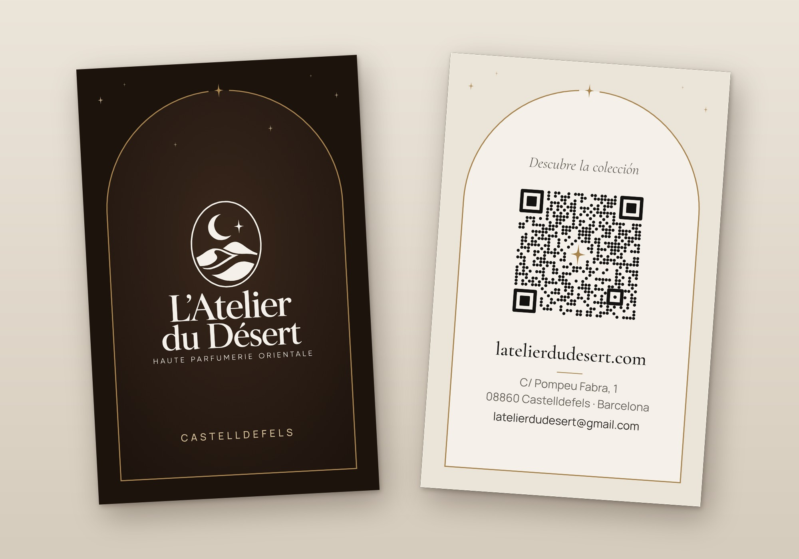

# Tarjeta de visita



Tarjeta de visita de la tienda, con un QR que abre el catálogo. Decisiones en [DECISIONS.md](../../DECISIONS.md) §142 (primera versión) y §143 (diseño definitivo, preparado para Instaprint).

## Diseño: la puerta del atelier

Tarjeta vertical de 55 × 85 mm con las esquinas rectas. Un arco de medio punto, a trazo fino dorado y cerrado abajo, es la puerta de la tienda y ocupa la misma posición en las dos caras: la noche y el día del desierto del emblema. Dentro del arco va todo el contenido; fuera, en las esquinas de arriba, unas estrellas pequeñas.

- **Anverso (la noche):** fuera del arco, oud profundo (`#1c130d`); dentro, oud (`#2a1d15`) con un resplandor tenue, como una puerta con luz. El logotipo completo en marfil, en un solo color y sin cambios, como piden sus reglas ([Logo.tsx](../../../src/modules/brand/Logo.tsx)). En la clave del arco, la estrella de cuatro puntas del emblema; abajo, «Castelldefels».
- **Reverso (el día):** fuera del arco, arena (`#ebe4d8`); dentro, marfil (`#f5f1ea`). «Descubre la colección», el QR, la web, un filete dorado, la dirección y el correo.
- **Solo en castellano:** el QR abre la web en el idioma del móvil, así que la tarjeta no necesita repetir textos en otros idiomas. La dirección va como «C/ Pompeu Fabra, 1», que vale para el nombre oficial en catalán y se lee en castellano.
- **QR propio:** puntos en lugar de cuadrados (granos de arena o estrellas) y la estrella del emblema en dorado en el centro.

Colores y tipografías del sistema de diseño ([DESIGN_SYSTEM.md](../../DESIGN_SYSTEM.md)): tinta, humo, marfil, arena, oud y los tres dorados; Cormorant Garamond y Manrope. El dorado solo va en líneas y estrellas, nunca en el logotipo.

## El QR

- **Destino:** `https://latelierdudesert.com/catalogo`. La web lo redirige al catálogo en el idioma del navegador: `/es/catalogo`, `/ca/cataleg` o `/en/catalog` (comprobado el 13/10/2026 en producción).
- **Código:** versión 5 (37 × 37 módulos) con corrección H (hasta un 30 %), que es la que permite la estrella central. Sin parámetros de seguimiento: una URL corta da un QR menos denso.
- **Tamaño:** 24 mm de lado (0,65 mm por módulo) y más de 4 módulos de margen libre hasta el texto y el arco.
- **Ojos casi cuadrados:** con las esquinas muy redondeadas, el lector de OpenCV dejaba de leerlo; los puntos no le afectan.
- **Comprobado:** zxing-cpp lo lee en el PDF rasterizado a 600 ppp, en el reverso a varias escalas y en 40 fotos simuladas (perspectiva, giro, desenfoque, ruido y luz desigual); OpenCV, en el reverso a tamaño real. El generador lo vuelve a leer cada vez.
- **Antes de imprimir el pedido completo:** escanearlo con dos móviles distintos en la prueba impresa.
- **Mientras haya tarjetas en circulación**, `latelierdudesert.com/catalogo` tiene que seguir funcionando: si cambia el dominio o la ruta, hay que mantener una redirección.

## Datos

Solo datos reales (nada inventado, CLAUDE.md):

- dirección: la de la tienda en Panel → Configuración y en el aviso legal (Carrer de Pompeu Fabra, 1, 08860 Castelldefels), abreviada como «C/ Pompeu Fabra, 1»;
- correo: `latelierdudesert@gmail.com`, el del pie de la web;
- web: `latelierdudesert.com`.

No lleva teléfono ni Instagram porque todavía no están en Panel → Configuración. Para añadirlos, se escriben en `CONTACT` de [generar/tarjeta.py](generar/tarjeta.py) (hasta cuatro líneas) y se regenera.

## Para la imprenta

- **Archivo:** [tarjeta-visita.pdf](tarjeta-visita.pdf). Dos páginas de 61 × 91 mm: la tarjeta de 55 × 85 mm (vertical) más 3 mm de sangrado por lado. Página 1, anverso; página 2, reverso, en la misma orientación. Si la imprenta pide un archivo por cara, están [tarjeta-visita-anverso.pdf](tarjeta-visita-anverso.pdf) y [tarjeta-visita-reverso.pdf](tarjeta-visita-reverso.pdf). Llevan TrimBox y BleedBox, textos en curvas (sin tipografías) y color RGB, que la imprenta convierte a CMYK con su perfil.
- **Margen de seguridad:** todo el texto queda a 4 mm o más del corte; el arco, a 4,5 mm por los lados y por abajo.
- **Prueba de color:** el oud y el dorado son los tonos que más cambian al pasar a CMYK; la primera tirada corta sirve de prueba.
- **Trazos finos:** el lema «Haute Parfumerie Orientale» del logotipo tiene trazos de 0,1 mm en marfil sobre el fondo oscuro. Lo resuelven bien la impresión digital de calidad y el offset; conviene comprobarlo en la prueba.

### Pedido en Instaprint (Barcelona)

Instaprint pide justo este archivo: 85 × 55 mm, 3 mm de sangrado, 300 ppp como mínimo y tipografías en curvas ([su ficha](https://instaprint.es/imprenta-online/tarjetas-de-visita-baratas/), consultada el 14/10/2026).

1. **Producto:** «Tarjetas Laminadas», en mate (desde 15,61 € con IVA), porque el plastificado protege el fondo oscuro de roces y marcas. Alternativa más barata: «Tarjetas Básicas» en Cartulina Estucada Mate de 350 g (desde 11,98 € con IVA).
2. **Configurar:** 8,5 × 5,5 cm, impresión a 2 caras y la cantidad (de 100 a 5.000).
3. **Subir:** `tarjeta-visita.pdf`, o los dos PDF por cara si el formulario pide uno para cada lado.
4. **En las observaciones del pedido:** «Tarjeta vertical. Página 1, anverso; página 2, reverso, en la misma orientación. Sangrado de 3 mm incluido y textos en curvas. Color en RGB: convertidlo con vuestro perfil, sin cambiar el diseño». La revisión y adaptación del archivo es gratis.
5. **Entrega:** en 24–48 h, con recogida en C/ Vilamarí 25 (Barcelona) o envío. El código «HAPPYPRINTING» daba un 10 % en el primer pedido.
6. **Al recibirlas:** escanear el QR con dos móviles distintos antes de repartirlas.

Mejora opcional: sus «Tarjetas Canto Impreso» (desde 78,65 €) imprimen el canto en el color que se elija; un canto oud o dorado remata la tarjeta.

### Otros papeles y acabados

- **Papel de algodón sin estucar** (de 600 a 700 g, en otras imprentas): más táctil y se puede perfumar como una mouillette. Sin plastificar, el fondo oscuro se marca más con el roce.
- **Estampado dorado:** si se quiere el arco y las estrellas en oro de estampación, la imprenta pide una capa aparte con esos elementos; se genera a petición. El logotipo nunca va en dorado.

## Archivos

| Archivo                                                  | Qué es                                                  |
| -------------------------------------------------------- | ------------------------------------------------------- |
| [tarjeta-visita.pdf](tarjeta-visita.pdf)                 | Archivo de imprenta (anverso y reverso, con sangrado)   |
| [tarjeta-visita-anverso.pdf](tarjeta-visita-anverso.pdf) | Solo el anverso, con sangrado                           |
| [tarjeta-visita-reverso.pdf](tarjeta-visita-reverso.pdf) | Solo el reverso, con sangrado                           |
| [tarjeta-visita-anverso.png](tarjeta-visita-anverso.png) | Anverso al corte, 384 ppp                               |
| [tarjeta-visita-reverso.png](tarjeta-visita-reverso.png) | Reverso al corte, 384 ppp                               |
| [tarjeta-visita-maqueta.jpg](tarjeta-visita-maqueta.jpg) | Las dos caras juntas, para enseñarla                    |
| [qr-catalogo.svg](qr-catalogo.svg)                       | El QR suelto, con margen, para otros usos (bolsa, caja) |
| [generar/tarjeta.py](generar/tarjeta.py)                 | Generador de todo lo anterior                           |
| [generar/requirements.txt](generar/requirements.txt)     | Sus dependencias, con versión exacta                    |

## Regenerar

El generador va en Python, fuera de la app: no entra en `package.json` ni en `pnpm check`. Compone las dos caras en SVG (medidas en mm), convierte los textos en curvas con HarfBuzz y fontTools, imprime el PDF con el Chromium de Playwright, ajusta las cajas con pypdf y vuelve a leer el QR. Las tipografías se descargan de google/fonts (licencia OFL) a una carpeta temporal.

```sh
python3 -m venv /tmp/tarjeta
/tmp/tarjeta/bin/pip install -r docs/brand/tarjetas/generar/requirements.txt
/tmp/tarjeta/bin/python docs/brand/tarjetas/generar/tarjeta.py
```

Usa el Chromium de `/opt/pw-browsers/chromium` o el de la variable `PLAYWRIGHT_CHROMIUM`.
